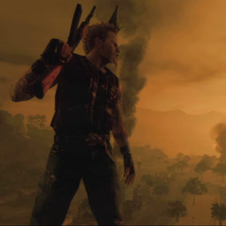

Автор: [github.com/penettrator](https://github.com/penettrator)

Поддержать автора: [boosty.to/itgenius](https://boosty.to/itgenius), донаты помогают выпускать новые порты.

<div align=center>



</div>
<h1 align=center>Mercenaries 2: World in Flames — Nintendo Switch</h1>

Нативный порт Xbox 360 версии **Mercenaries 2: World in Flames** (Pandemic Studios, 2008) на Nintendo Switch.
Это статическая рекомпиляция: код игры (`default.xex`, PowerPC) переведён в C++ с помощью
[ReXGlue](https://github.com/rexglue/rexglue-sdk) и собран под Horizon, графика выводится собственным рендерером
через Vulkan (драйвер NVK из Mesa). Это не эмулятор.

> [!IMPORTANT]
> **Нужна лицензионная копия игры.** В репозитории и в релизах нет файлов игры. Нужен ваш диск
> **Mercenaries 2: World in Flames для Xbox 360** (образ `.iso` или распакованная папка с `default.xex`).
> Поддерживается издание с `default.xex` SHA-256 `48e805e4a2c1c4f7b409245dc9f2d02e2e8a94eaa0e9f1744d150ddce00bf72b`.

## Что нужно

- Nintendo Switch с кастомной прошивкой **Atmosphère**.
- Менеджер установки NSP (**DBI**, **Sphaira** и т.п.) для иконки на главном экране, или **hbmenu** для запуска через R.
- Плагин разгона (например, **sys-clk**), настоятельно рекомендуется.
- Около 6.5 ГБ свободного места на SD-карте (рекомендуется exFAT).

## Установка

### 1. Файлы порта

Скачайте из раздела [**Releases**](../../releases/latest):

| Файл | Что это |
|---|---|
| `Mercenaries2-NX.zip` | Порт: `switch/Mercenaries2/mercenaries2.nro` и `mercenaries2.toml` |
| `Mercenaries2-forwarder.nsp` | Иконка на главном экране Switch (форвардер) |
| `SHA256SUMS` | Контрольные суммы |

Распакуйте `Mercenaries2-NX.zip` в корень SD-карты, получится `sdmc:/switch/Mercenaries2/`.

### 2. Образ игры

Если у вас уже есть распакованная папка игры (с `default.xex` внутри), переходите к шагу 3.

Образ `.iso` распаковывается утилитой **extract-xiso**:

1. Скачайте её со страницы [github.com/XboxDev/extract-xiso/releases](https://github.com/XboxDev/extract-xiso/releases)
   (для Windows файл `extract-xiso-win32-release.zip`) и распакуйте.
2. Положите образ игры рядом с `extract-xiso.exe`, откройте в этой папке командную строку и выполните:
   ```
   extract-xiso.exe -x "Mercenaries 2.iso" -d game_root
   ```
   Вместо `Mercenaries 2.iso` подставьте имя своего файла. Можно и проще: перетащите `.iso` мышкой на
   `extract-xiso.exe`, рядом появится папка с файлами игры (переименуйте её в `game_root`).
3. В папке должны оказаться `default.xex`, файлы `*.wad`, `shaders.bin`, папки `audios` и `movies`
   (всего около 6.4 ГБ). Папка `$SystemUpdate`, если есть, игре не нужна, её можно удалить.

Проверить издание (необязательно):
```
certutil -hashfile game_root\default.xex SHA256
```
Должно получиться `48e805e4a2c1c4f7b409245dc9f2d02e2e8a94eaa0e9f1744d150ddce00bf72b`. Порт собран из этого
`default.xex`, с другими изданиями игра может не запуститься или работать с ошибками.

### 3. Копирование на Switch

Скопируйте папку `game_root` целиком в `sdmc:/switch/Mercenaries2/`.

### Структура папок

```text
sdmc:/switch/Mercenaries2/
  ├── mercenaries2.nro     (порт)
  ├── mercenaries2.toml    (настройки)
  ├── game_root/           (файлы с вашего диска: default.xex, *.wad, shaders.bin, audios/, movies/)
  └── logs/                (создаётся игрой: логи, скриншоты)
```

> [!NOTE]
> **Обновление.** При выходе новой версии `game_root` копировать заново не нужно: распакуйте поверх новый
> `Mercenaries2-NX.zip`. Он заменит `mercenaries2.toml`, поэтому сначала запишите свои изменённые настройки.

## Запуск

### Способ 1: иконка на главном экране (рекомендуется)

1. Установите `Mercenaries2-forwarder.nsp` через DBI, Sphaira или другой менеджер, как обычную игру.
2. На главном экране появится иконка **Mercenaries 2: World in Flames**. Запускайте игру с неё.

Форвардер не содержит игру: он запускает `sdmc:/switch/Mercenaries2/mercenaries2.nro` со всей памятью приложения
(39-битное адресное пространство). Установить один NSP без шагов 1–3 недостаточно.

### Способ 2: через другую игру

1. Зажмите **R** и запустите любую установленную игру, откроется hbmenu в полном режиме (title override).
2. Выберите **Mercenaries 2: World in Flames**.

> [!CAUTION]
> Не запускайте через Альбом: в режиме апплета игре не хватит памяти.
> Первый запуск дольше обычного, собирается кэш шейдеров. Со второго запуска загрузка быстрее.

## Разгон

| | Частота |
|---|---|
| CPU | 1571–1785 МГц |
| GPU | 768 МГц |
| RAM | 2133 МГц |

- Видеочип использует общую с процессором память: **не снижайте частоту RAM**, иначе FPS заметно упадёт.
- Снижение GPU ниже 768 МГц даёт сильные просадки.
- CPU можно опустить до 1571 МГц для меньшего нагрева.
- **После смены частот разгона игру нужно перезапустить.**

Без разгона игра запускается, но FPS заметно ниже.

## Настройки

Все настройки в `sdmc:/switch/Mercenaries2/mercenaries2.toml`. Изменения применяются после перезапуска игры.

| Параметр | По умолчанию | Описание |
|---|---|---|
| `user_language` | `12` | Язык игры: `12` — русский, `1` — английский |
| `present_effect` | `"fsr"` | Апскейл на экран: `"fsr"`, `"cas"` (только резкость), `"bilinear"` |
| `mercs2_native_shadow_max_cascades` | `3` | Каскады теней: `4` — дальние тени как в оригинале (медленнее) |
| `mercs2_native_max_anisotropy` | `8` | Анизотропная фильтрация (1–16) |
| `mercs2_native_texture_pool` | `true` | Общий пул видеопамяти для текстур (меньше рывков) |

## Известные проблемы

- Просадки FPS при езде на технике и в перестрелках с большим количеством взрывов.
- Дальние тени (дальше ~130 м) отключены ради производительности, см. `mercs2_native_shadow_max_cascades`.

## Как это устроено

Это не эмулятор. Машинный код PowerPC из `default.xex` заранее переводится в C++ утилитой
[ReXGlue](https://github.com/rexglue/rexglue-sdk) и компилируется в ARM64-код для Horizon (Switch). Ядро и рантайм
Xbox 360 (потоки, память, файлы, звук XMA) реализованы в SDK. Команды видеочипа Xenos переводит в Vulkan собственный
рендерер порта (`app/src/native`), который работает поверх драйвера NVK из Mesa. Сцена рисуется в 960x544 и
растягивается на экран через AMD FSR 1.

Сгенерированный из игры код (`app/generated`) в репозиторий не входит: он создаётся при сборке из вашего `default.xex`.

## Благодарности

- [ReXGlue SDK](https://github.com/rexglue/rexglue-sdk) и [Xenia](https://xenia.jp) — рекомпилятор, рантайм Xbox 360, обработка команд GPU.
- [masseffect-nx](https://github.com/nebadasSwifty/masseffect-nx) — SDK для Horizon и опыт оптимизаций.
- [project8-sw](https://github.com/R-drg/project8-sw), [the-simpsons-game-nx](https://github.com/R-drg/the-simpsons-game-nx),
  [NFSMW-NX](https://github.com/StevensND/NFSMW-NX) — нативный рендерер и слой Horizon.
- [mesa-switch](https://github.com/danfromtico/mesa-switch) и [Mesa](https://mesa3d.org) — драйвер Vulkan (NVK/NAK) для Switch.
- [AMD FidelityFX FSR 1](https://github.com/GPUOpen-Effects/FidelityFX-FSR) — апскейл.

## Поддержка

Если порт вам понравился, поддержать автора можно на [boosty.to/itgenius](https://boosty.to/itgenius):
донаты помогают выпускать новые порты.

## Лицензия

Код порта распространяется по лицензии **GPL-3.0** (см. [LICENSE](LICENSE)).
Сторонние компоненты — под своими лицензиями (BSD-3-Clause, MIT, LGPL-2.1 и др.), см.
[THIRD_PARTY_NOTICES.md](THIRD_PARTY_NOTICES.md).

Mercenaries 2: World in Flames — торговая марка ее правообладателей. Проект не связан с Electronic Arts,
Pandemic Studios, Microsoft или Nintendo и не содержит их файлов.
